

  <a href="https://github.com/KanaxNguyen"></a>

  
  
  

  
  
  

👇 Click a language to open or close it · Bấm vào ngôn ngữ để mở hoặc đóng

<kbd>&nbsp;🇬🇧&nbsp;&nbsp;<b>English</b>&nbsp;</kbd>

## 👋 About me

- 🎓 AI undergraduate at **FPT University Hanoi**
- 🛠️ I turn real problems into **working prototypes, end to end**: model → backend → edge device → iOS app
- 👁️ Focus: **Computer Vision, Edge AI**, on-device ML
- 📄 Co-author, **AIRoSIP 2026** (accepted)
- 🧑‍💼 Head of Technical Committee, **Tech-Fest 2026**
- 🌏 Vietnamese · English (B2) · Japanese (basic)

## 🚀 Featured projects

  <a href="https://github.com/KanaxNguyen/CabinSentinel-iOS">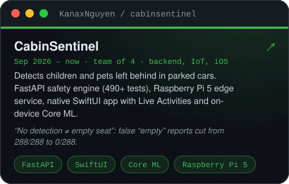</a>
  <a href="https://github.com/KanaxNguyen/huce-teaching-assignment-mvp">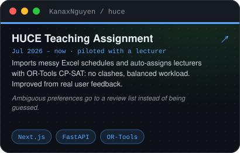</a>

  <a href="https://github.com/KanaxNguyen/DAP_Project_ADAS_support">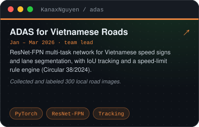</a>
  <a href="https://www.kaggle.com/code/asdhjasdjhka/vinfast-detector-v3-1">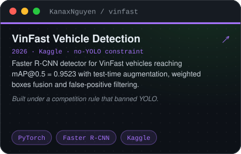</a>

<b>➕ More projects</b>

 

| Project | What it does | Stack |
|---|---|---|
| [DepthLab](https://github.com/KanaxNguyen/DepthLab) | Measures how far iPhone LiDAR and TrueDepth can be trusted | SwiftUI, ARKit |
| [Datathon 2026](https://github.com/KanaxNguyen/Datathon2026-BFE) | Top 50 at VinUni-Datathon 2026 · revenue forecasting, R² 0.625 | XGBoost |
| [HSR PyTorch MVP](https://github.com/KanaxNguyen/aiforinnovation) | Railway demand, cancellation and pricing | PyTorch, Streamlit |
| [Face Attendance](https://github.com/KanaxNguyen/face-attendance-demo-public) | Role-based attendance, no camera frames stored | Flask, FaceNet |
| [Pose Match Game](https://github.com/KanaxNguyen/Check_pose_game-) | Pose game built for an FPTU AI Club event | MediaPipe |
| [SnapTask AI](https://github.com/KanaxNguyen/SnapTask) | Screenshots → prioritised to-do list | React, Gemini |
| [CabinSentinel-mobile](https://github.com/KanaxNguyen/CabinSentinel-mobile) | Expo / React Native client | TypeScript |

## 📄 Research

> **AI-Driven Market Traction Forecasting for Digital Creative Products: Evidence from Indie Games on Steam**
> V. N. Anh, **N. N. Khanh**, L. H. T. Lam, D. V. Hieu · *Accepted, AIRoSIP 2026*

Owned data collection and pipeline design: **5,997 games × 52 features** from 4 public sources. XGBoost cut log RMSE by **15.1%** vs. Ridge; chronological validation showed random splits overstate R² (**0.70 vs. 0.45**).

## 🧑‍💼 Leadership

| Role | Organisation | Time |
|---|---|---|
| Head of Technical Committee | Tech-Fest 2026: Tech Journey, FPTU AI Club | Jul 2026 – now |
| Vice Head, Technical Committee | FPTU AI Club | now |
| Volunteer Organizer | FANROC Robotics Competition | 2026 |

## 🛠️ Tech stack

  

| | |
|---|---|
| 👁️ **Computer Vision & Edge AI** | PyTorch · OpenCV · YOLOv8 · Faster R-CNN · NCNN · Core ML · Raspberry Pi 5 |
| 📊 **AI & Data** | scikit-learn · XGBoost · SQL · OR-Tools CP-SAT · RAG · LLM agents |
| 🧩 **Engineering** | Python · FastAPI · Swift / SwiftUI · Next.js · Docker · pytest |

<b>🧪 AI20K coursework labs (Cohort 4)</b>

 

| Day | Topic |
|---|---|
| [01](https://github.com/KanaxNguyen/K4-L3-Day1-AI-LLM-Foundation) | LLM API basics |
| [11](https://github.com/KanaxNguyen/K4-L3-DAY11-NguyenNamKhanh-2A202602568-Guardrails-HITL-Responsible-AI) | Guardrails, human-in-the-loop, responsible AI |
| [12](https://github.com/KanaxNguyen/K4-L3A-DAY12-NguyenNamKhanh-2A202602568-CloudServicesAndDeployment) | Cloud services & deployment |
| [13](https://github.com/KanaxNguyen/K4-L3-DAY13-NguyenNamKhanh-2A202602568-Monitoring-LLMOps) | Monitoring & LLMOps |
| [14](https://github.com/KanaxNguyen/K4-L3A-DAY14-NguyenNamKhanh-2A202602568-AIEvaluation) | RAG evaluation with a golden dataset |
| [17](https://github.com/KanaxNguyen/K4-DAY17-NguyenNamKhanh-2A202602568) | Memory systems for AI agents |
| [18](https://github.com/KanaxNguyen/K4-Track3A-DAY18-NguyenNamKhanh-2A202602568-ProductionRAG) | Production RAG |
| [19](https://github.com/KanaxNguyen/K4-DAY19-NguyenNamKhanh-2A202602568) | Flat RAG vs. GraphRAG |
| [20](https://github.com/KanaxNguyen/K4-DAY20-MULTIAGENTS-NguyenNamKhanh-2A202602568) | Multi-agent systems |
| [21](https://github.com/KanaxNguyen/Day21-Track3-NguyenNamKhanh-2A202602568-Finetuning-Lab) | LoRA fine-tuning |
| [22](https://github.com/KanaxNguyen/K4-DAY22-NguyenNamKhanh-2A202602568) | DPO / ORPO alignment |
| [25](https://github.com/KanaxNguyen/Track3-Day25-2A202602568-NguyenNamKhanh) | Agent reliability: circuit breakers, caching |
| [26](https://github.com/KanaxNguyen/K4-DAY26-NguyenNamKhanh-2A202602568) | MCP vs. function calling |
| [27](https://github.com/KanaxNguyen/K4-DAY27-NguyenNamKhanh-2A202602568) | Human-in-the-loop: confidence routing |

## 📊 GitHub activity

  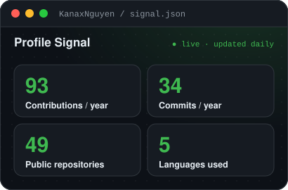
  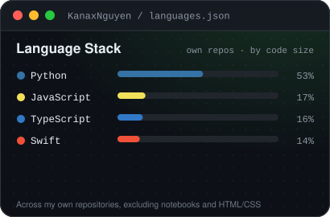

  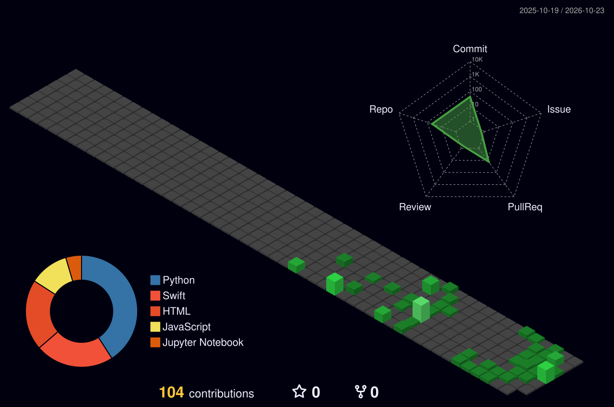

Cards are generated from live GitHub data every day.

<kbd>&nbsp;🇻🇳&nbsp;&nbsp;<b>Tiếng Việt</b>&nbsp;</kbd>

## 👋 Về mình

- 🎓 Sinh viên ngành AI tại **Đại học FPT Hà Nội**
- 🛠️ Biến bài toán thật thành **sản phẩm chạy được từ đầu đến cuối**: mô hình → backend → thiết bị → app iOS
- 👁️ Trọng tâm: **Thị giác máy tính, Edge AI**, ML chạy trên thiết bị
- 📄 Đồng tác giả bài báo **AIRoSIP 2026** (đã được chấp nhận)
- 🧑‍💼 Trưởng ban Kỹ thuật **Tech-Fest 2026**
- 🌏 Tiếng Việt · Tiếng Anh (B2) · Tiếng Nhật (cơ bản)

## 🚀 Dự án nổi bật

  <a href="https://github.com/KanaxNguyen/CabinSentinel-iOS">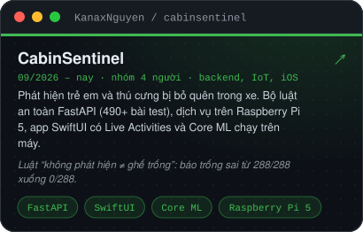</a>
  <a href="https://github.com/KanaxNguyen/huce-teaching-assignment-mvp">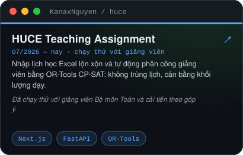</a>

  <a href="https://github.com/KanaxNguyen/DAP_Project_ADAS_support">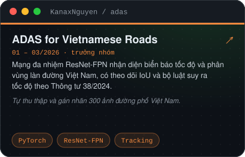</a>
  <a href="https://www.kaggle.com/code/asdhjasdjhka/vinfast-detector-v3-1">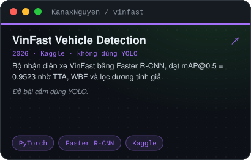</a>

<b>➕ Dự án khác</b>

 

| Dự án | Nội dung | Công nghệ |
|---|---|---|
| [DepthLab](https://github.com/KanaxNguyen/DepthLab) | Đo LiDAR và TrueDepth trên iPhone nhìn xa, tin cậy tới đâu | SwiftUI, ARKit |
| [Datathon 2026](https://github.com/KanaxNguyen/Datathon2026-BFE) | Top 50 VinUni-Datathon 2026 · dự báo doanh thu, R² 0.625 | XGBoost |
| [HSR PyTorch MVP](https://github.com/KanaxNguyen/aiforinnovation) | Dự báo nhu cầu, hủy vé và giá vé đường sắt | PyTorch, Streamlit |
| [Face Attendance](https://github.com/KanaxNguyen/face-attendance-demo-public) | Điểm danh bằng khuôn mặt, phân quyền, không lưu ảnh camera | Flask, FaceNet |
| [Pose Match Game](https://github.com/KanaxNguyen/Check_pose_game-) | Game bắt chước tư thế cho sự kiện FPTU AI Club | MediaPipe |
| [SnapTask AI](https://github.com/KanaxNguyen/SnapTask) | Ảnh chụp màn hình → danh sách việc có ưu tiên | React, Gemini |
| [CabinSentinel-mobile](https://github.com/KanaxNguyen/CabinSentinel-mobile) | App Expo / React Native | TypeScript |

## 📄 Nghiên cứu

> **AI-Driven Market Traction Forecasting for Digital Creative Products: Evidence from Indie Games on Steam**
> V. N. Anh, **N. N. Khanh**, L. H. T. Lam, D. V. Hieu · *Đã được chấp nhận tại AIRoSIP 2026*

Phụ trách thu thập dữ liệu và thiết kế pipeline: gộp 4 nguồn công khai thành **5.997 game × 52 đặc trưng**. XGBoost giảm log RMSE **15,1%** so với Ridge; kiểm định theo thời gian cho thấy chia ngẫu nhiên làm R² bị thổi phồng (**0,70 so với 0,45**).

## 🧑‍💼 Hoạt động

| Vai trò | Tổ chức | Thời gian |
|---|---|---|
| Trưởng ban Kỹ thuật | Tech-Fest 2026: Tech Journey, FPTU AI Club | 07/2026 – nay |
| Phó ban Kỹ thuật | FPTU AI Club | hiện tại |
| Tình nguyện viên tổ chức | Cuộc thi Robotics FANROC | 2026 |

## 🛠️ Công nghệ

  

| | |
|---|---|
| 👁️ **Thị giác máy tính & Edge AI** | PyTorch · OpenCV · YOLOv8 · Faster R-CNN · NCNN · Core ML · Raspberry Pi 5 |
| 📊 **AI & Dữ liệu** | scikit-learn · XGBoost · SQL · OR-Tools CP-SAT · RAG · LLM agent |
| 🧩 **Kỹ thuật phần mềm** | Python · FastAPI · Swift / SwiftUI · Next.js · Docker · pytest |

<b>🧪 Các bài lab AI20K (Khóa 4)</b>

 

| Ngày | Chủ đề |
|---|---|
| [01](https://github.com/KanaxNguyen/K4-L3-Day1-AI-LLM-Foundation) | Làm quen LLM API |
| [11](https://github.com/KanaxNguyen/K4-L3-DAY11-NguyenNamKhanh-2A202602568-Guardrails-HITL-Responsible-AI) | Guardrails, con người trong vòng lặp, AI có trách nhiệm |
| [12](https://github.com/KanaxNguyen/K4-L3A-DAY12-NguyenNamKhanh-2A202602568-CloudServicesAndDeployment) | Dịch vụ đám mây và triển khai |
| [13](https://github.com/KanaxNguyen/K4-L3-DAY13-NguyenNamKhanh-2A202602568-Monitoring-LLMOps) | Giám sát và LLMOps |
| [14](https://github.com/KanaxNguyen/K4-L3A-DAY14-NguyenNamKhanh-2A202602568-AIEvaluation) | Đánh giá RAG với golden dataset |
| [17](https://github.com/KanaxNguyen/K4-DAY17-NguyenNamKhanh-2A202602568) | Bộ nhớ cho AI agent |
| [18](https://github.com/KanaxNguyen/K4-Track3A-DAY18-NguyenNamKhanh-2A202602568-ProductionRAG) | RAG cho production |
| [19](https://github.com/KanaxNguyen/K4-DAY19-NguyenNamKhanh-2A202602568) | Flat RAG và GraphRAG |
| [20](https://github.com/KanaxNguyen/K4-DAY20-MULTIAGENTS-NguyenNamKhanh-2A202602568) | Hệ đa agent |
| [21](https://github.com/KanaxNguyen/Day21-Track3-NguyenNamKhanh-2A202602568-Finetuning-Lab) | Fine-tuning bằng LoRA |
| [22](https://github.com/KanaxNguyen/K4-DAY22-NguyenNamKhanh-2A202602568) | Căn chỉnh mô hình bằng DPO / ORPO |
| [25](https://github.com/KanaxNguyen/Track3-Day25-2A202602568-NguyenNamKhanh) | Độ tin cậy cho agent: circuit breaker, cache |
| [26](https://github.com/KanaxNguyen/K4-DAY26-NguyenNamKhanh-2A202602568) | MCP và Function Calling |
| [27](https://github.com/KanaxNguyen/K4-DAY27-NguyenNamKhanh-2A202602568) | Con người trong vòng lặp: định tuyến theo độ tin cậy |

## 📊 Hoạt động GitHub

  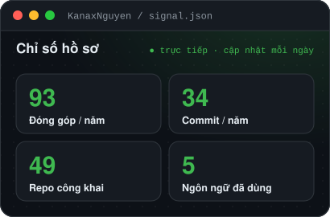
  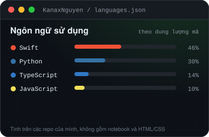

  

Các thẻ được tạo từ dữ liệu GitHub thật, cập nhật mỗi ngày.

